# 末日大逃殺 遊戲規則

城市被殭屍佔領了，唯一能逃的是撤離點那台壞掉的直升機。
大家一起把它修好、加滿油，一起透過直升機逃離這座城市。

每個人控制一隻卡皮巴拉，用程式下指令。一場 10 分鐘。

---

## 怎麼贏

1. 把零件搬回撤離點，零件湊滿，直升機就修好了。
2. 修好後地上會出現油桶，撿回撤離點，把油加滿。
3. 油一加滿，時間就停住，45 秒後直升機起飛。

起飛時人在撤離點，就算逃出去。

全班輸的情況：

- 時間到了，零件還沒湊滿
- 時間到了，油還沒加滿
- 所有人都被淘汰

要多少零件和油桶，看開場有幾個人。12 人大約要 75 個零件、7 桶油；20 人大約要 95 個零件、12 桶油。

---

## 一些圖示

| | | |
|:---:|:---:|:---:|
| 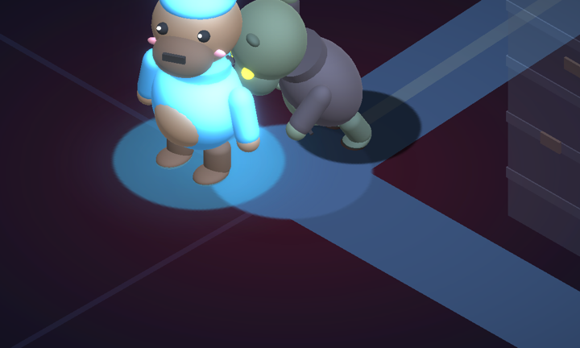 **你的卡皮巴拉** 這是你 | 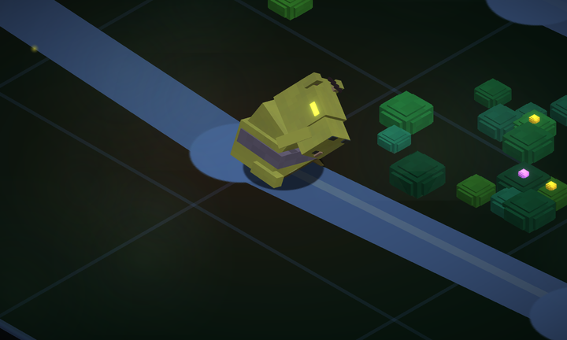 **殭屍** 看到你會追，被他咬會掉血、變感染 | 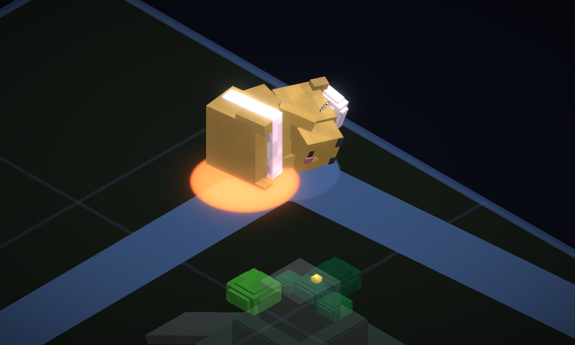 **倒地** 你睡著了 |
| 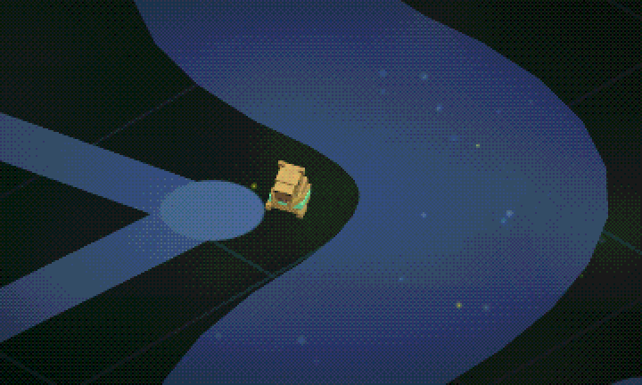 **民眾** 一開場就在地圖上等人救 | 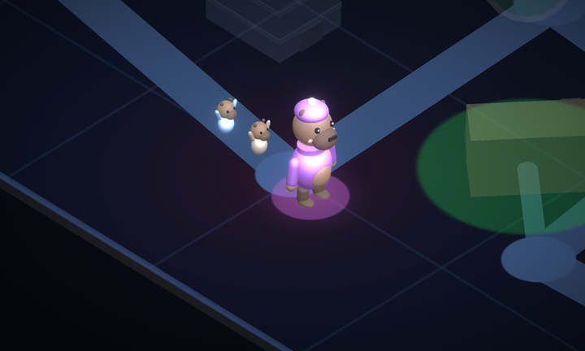 **帶著民眾** 他們會跟著你走 | 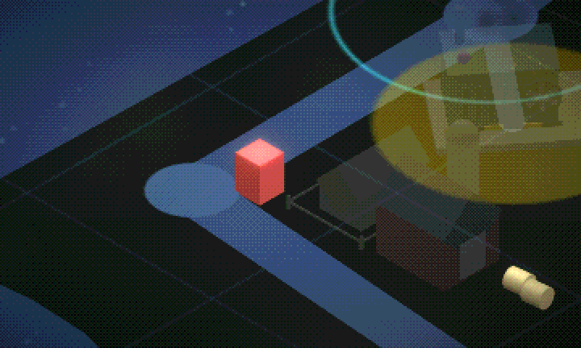 **油桶** 直升機修好後才出現 |
| 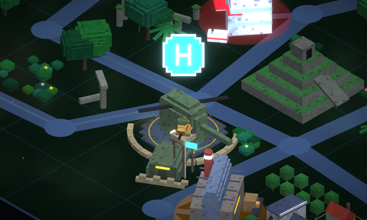 **撤離點** 出發、復活、交東西的地方 | 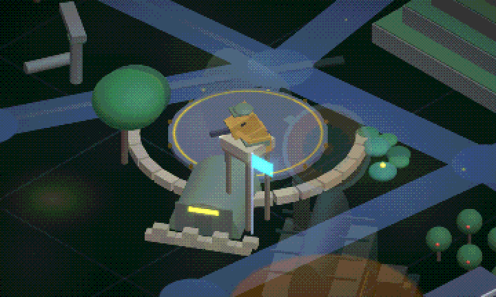 **守軍** 會射倒靠近撤離點的殭屍 | 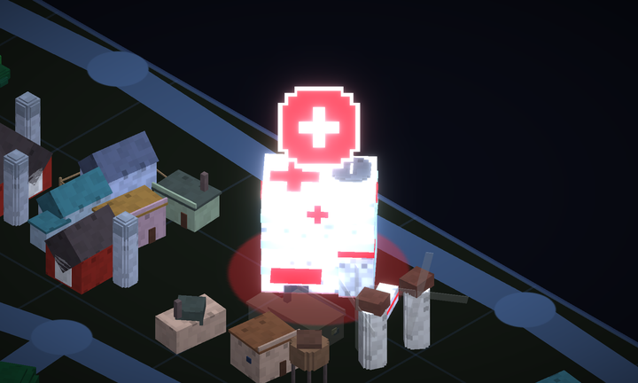 **醫院** 補滿血，殭屍進不來 |
| 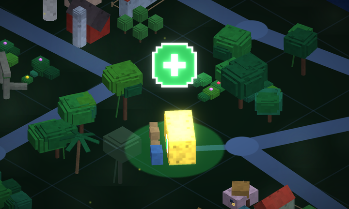 **補給站** 可以拿醫療包帶在身上 | 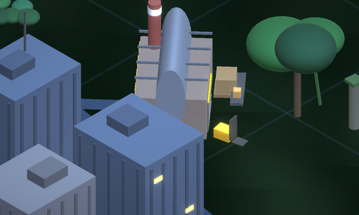 **工廠** 零件從這裡出來 | 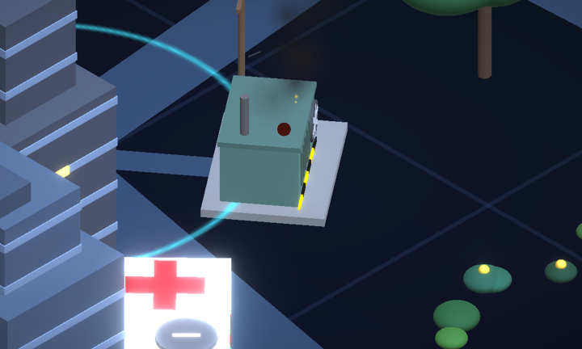 **發電機** 壞了工廠就停工，得修 |
| 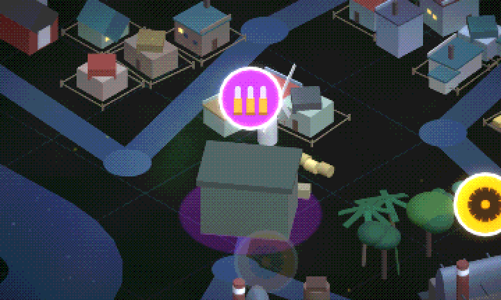 **軍火庫** 拿武器，一場只有一個 | | |

醫院、補給站、工廠、發電機、軍火庫的頭上都有圖示，地上有同顏色的光圈，遠遠就看得到。

### 零件、民眾、油桶

全部都是送回撤離點。背包最多裝 14，裝越重走越慢。

| | 重量 | 說明 |
|---|---|---|
| 零件 | 1–3 | 從有電的工廠拿 |
| 民眾 | 4 | 一開場就決定好，不會變多也不會消失 |
| 油桶 | 4 | 直升機修好後才出現，散在地圖邊緣 |
| 武器 | 1 | 從軍火庫拿，見下方 |

直升機修好之後，再送零件回去不會加分；油加滿之後，再送油桶也不會加分。
背包裡用不到的東西可以隨時丟掉，會掉在最近的路口，別人還能撿。

零件出現前 60 秒就會先公告，看得到在哪、什麼時候能拿。大約三成零件是**限時**的，在期限內送到會多拿 1.2 倍的獎金。

一趟要撿哪些、照什麼順序走、趕不趕得上限時，會差很多。

### 路和河

- 每場地圖的路都不一樣，彎彎曲曲的。路很疏，很多地方只有一兩條路能到，繞錯路會差很多。
- 河會把地圖切成差不多大的兩半，只有兩座橋，分在河的兩頭，過河常常要繞一大圈。
- **屍潮**會不定時堵住一段路（不會堵橋），沒辦法處理，只能等它散開或繞路。被堵住的路會變紅。
- **橋**只會因為「橋樑損毀」事件斷掉，斷了就一直斷著，要有人去修才會通。
- 也可以自己畫一張地圖來比賽，做法在 [game/editor/README.md](game/editor/README.md)。

### 軍火庫

一場只有一個，頭上是紫色的子彈圖示。在這裡可以拿一把武器（一次只能帶一把），最多存 4 把，每 45 秒補 1 把。

- 武器只重 1，幾乎不影響速度。
- 帶著武器時，4.5 格內的殭屍會被自動射倒，每 1.2 秒一發，一把 20 發，打完就沒了。
- 每射倒一隻殭屍 +8 分。
- 倒地的時候武器會不見。

### 發電機

河的兩邊各有一台發電機，管自己那一邊的工廠。

一開場兩台都是壞的，所以第一件事是去修發電機，不然沒有零件。
中期、後期一開始會各壞一台，平常很少會壞。壞了不會爆炸，只是那一邊停止出零件。

---

## 一場比賽的流程

| 時間 | 期間 |
|---|---|
| 0:00–2:30 | 前期 |
| 2:30–5:50 | 中期 |
| 5:50–8:20 | 後期 |
| 8:20–10:00 | 終局 |

越後面殭屍越快、事件越多、東西的分數也越高。

1:30 開始，安全區會往撤離點縮小。在圈外會一直掉血。

直升機修好的那一刻，大家血會補滿，圈內的殭屍會被清光。

右上角的圓盤是感染程度。數字越高，感染區擴散得越快。
感染很重的地方會長出殭屍，站在那裡不動也會被傳染。

---

## 突發事件

地圖上會出現各種事件，走過去處理就好。一個人也能做，人多比較快。
處理好有好處，放著不管通常會變得更糟。

| | | |
|:---:|:---:|:---:|
| 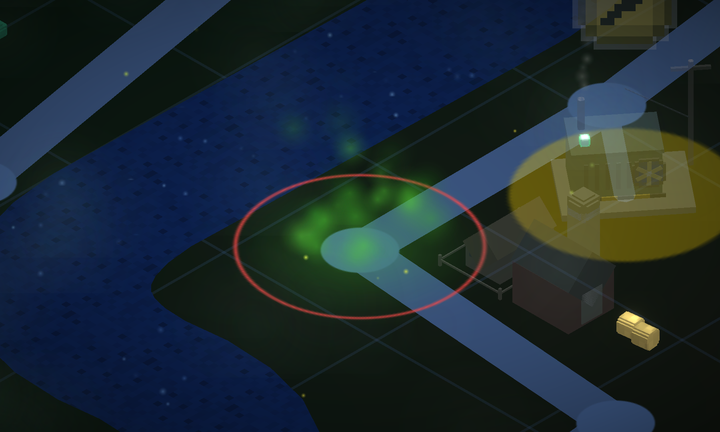 **感染爆發** 處理好：清光附近殭屍 沒處理：殭屍變多 | 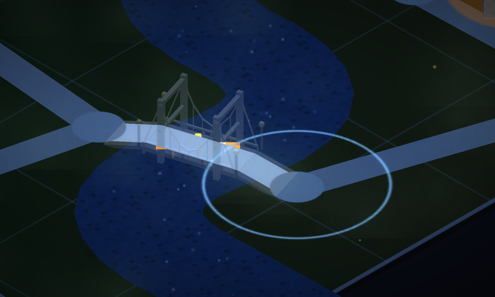 **橋樑損毀** 沒有時間限制，修好之前橋一直斷著 修好：全員加速 | 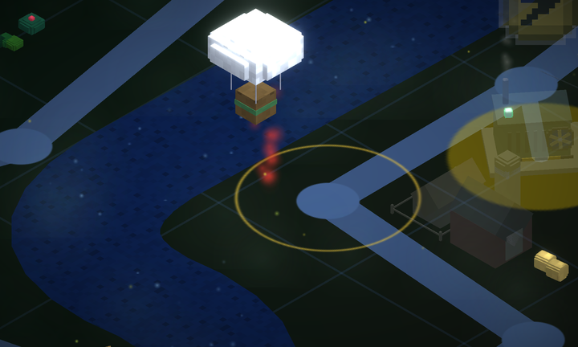 **物資空投** 處理好：全員補滿血 沒處理：什麼也拿不到 |
| 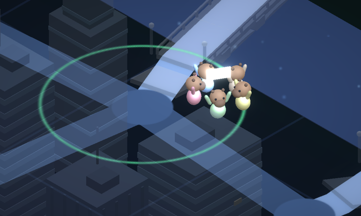 **受困人群** 處理好：多 4 位民眾可以救 沒處理：變成殭屍 | 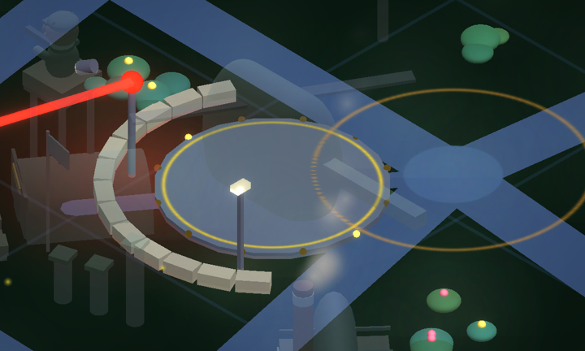 **撤離點告急** 處理好：撤離點附近殭屍清光 沒處理：守軍倒下一分鐘 | 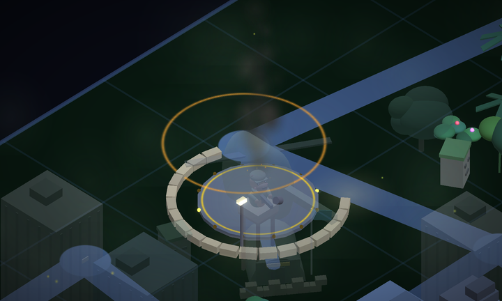 **直升機故障** 處理好：零件需求變少（修好後改成少要一桶油） 沒處理：零件要更多 |
| 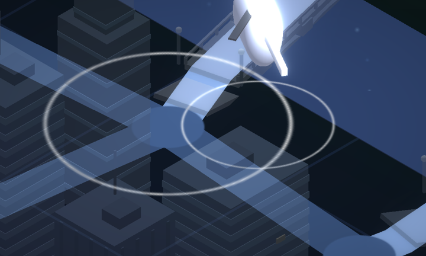 **醫療隊抵達** 很多人倒地時才出現 處理好：倒下的人全部復活 | 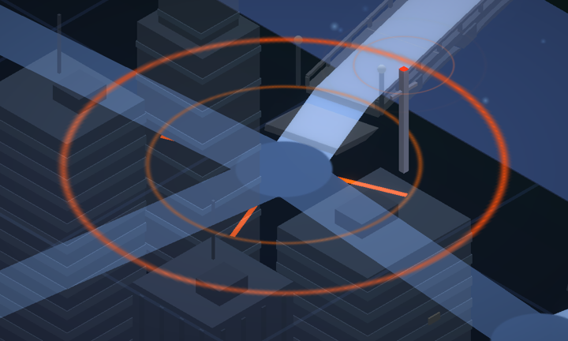 **呼叫空襲** 處理好：炸平事件所在的那半張地圖，殭屍全清 沒處理：轟炸機不會來 | 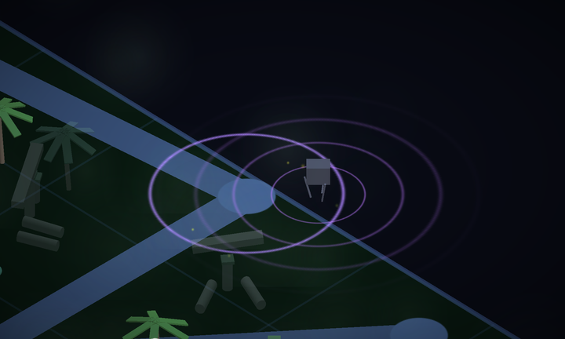 **聲波誘餌** 處理好：全城殭屍暫停 沒處理：沒有效果 |
| 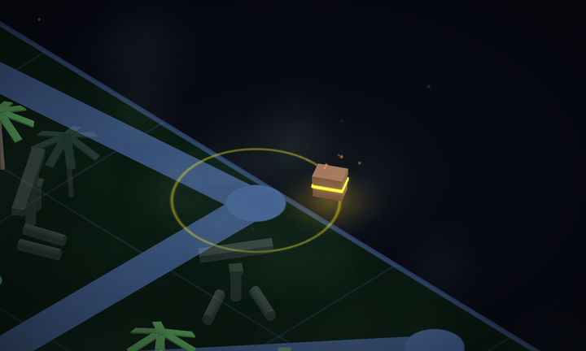 **神秘寶箱** 先到先拿，有零件和分數 | 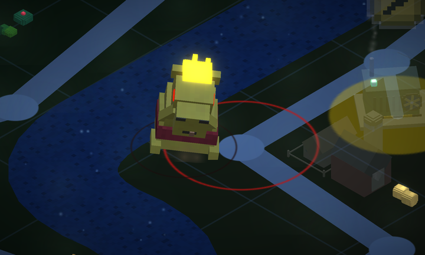 **殭屍王** 很硬，最好三個人一起打 |  **發電機故障** 沒有時間限制，修好工廠才有電 |
|  **草藥採集**（雨林） 處理好：30 秒內全員感染值不會上升，城市感染 -20% | 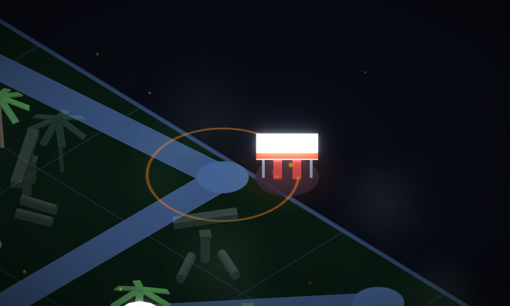 **加油站補給**（城市） 處理好：少要 3 桶油 沒處理：原地爆炸，附近的人和殭屍都會被炸傷 | 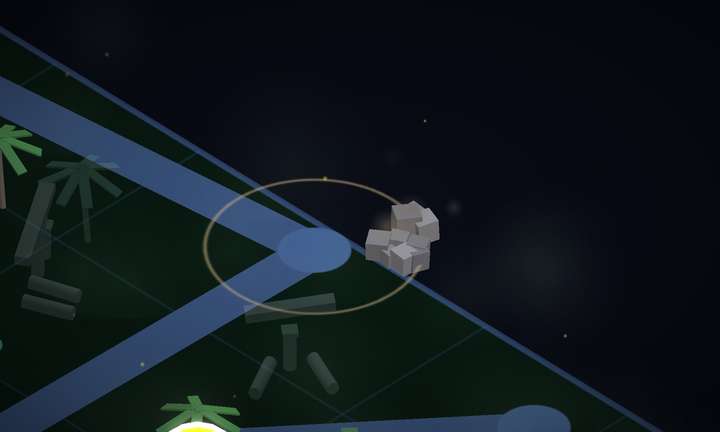 **瓦礫堆**（廢墟） 處理好：挖出零件 |
| 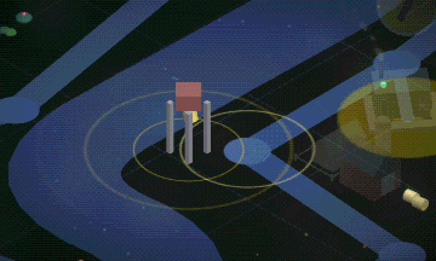 **教堂鐘聲**（小城鎮） 處理好：全地圖的民眾都自己去避難 | | |

地區事件只會出現在那個地區。地圖河的兩邊各是一種地區（雨林、城市、廢墟、小城鎮）。

---

## 你的卡皮巴拉

- 背越重走越慢：每背 1 重量，速度少 5%，背滿 10 只剩一半。血太少也會變慢。
- 指令送出後要等 15 秒才能再送。回撤離點、去醫院、用醫療包、丟東西這種指令隨時都能送。
- 血歸零或感染滿了就會倒地，身上的東西會掉在地上，還會扣分。
- 倒地 15 秒內有人走到你旁邊扶你，就能起來。沒人來的話：在安全區裡倒地，會回撤離點復活；在安全區外倒地，就被淘汰了。

---

## 殭屍

- 看到附近的人就會追，追人的時候跑得比平常快，貼到就咬。
- 數量會越來越多，後期滿街都是。
- 處理事件、搬東西的聲音會把殭屍引過來。
- 躲在撤離點或醫院裡就咬不到你。
- 帶著武器可以射倒靠近的殭屍。

---

## 分數

- 搬零件、民眾、油桶：越遠分數越高。
- 處理突發事件：大家一起做的話，照每個人做了多久來分。
- 扶起倒地的隊友：+60。
- 用武器射倒殭屍：每隻 +8。
- 搭上直升機：+100，再加上時間停住時剩下秒數的一半。越早起飛，大家加越多。
- 限時零件在期限內送到：多拿 1.2 倍獎金。
- 一趟帶好幾件回來一起交，從第 2 件起每件多 5%，最多 +40%。
- 倒地會扣分，倒越多次扣越多。

## 想自己畫地圖？
看看 [Map Editor](game/editor/README.md)

## 素材來源

卡皮巴拉模型：[Capybara](https://sketchfab.com/3d-models/capybara-b48dfa5224824446843b5870ea0794c1) by [Gotche](https://sketchfab.com/Gotche)， [CC BY 4.0](http://creativecommons.org/licenses/by/4.0/) 授權，遊戲中有轉換格式、調整顏色並加上配件。